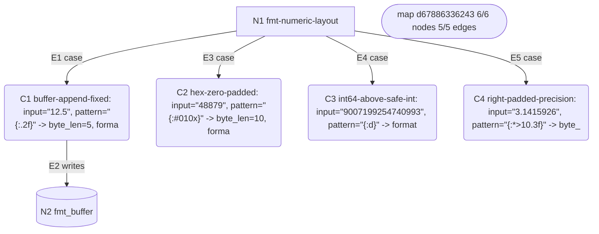
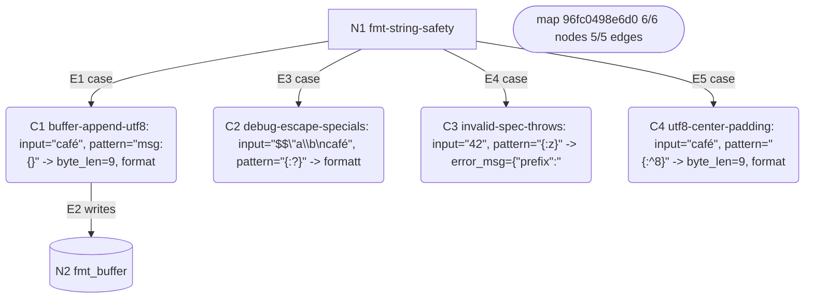

# DRIFT Real-World PR Showcase — `{fmt}` (C++20 / CMake)

This showcase demonstrates **[DRIFT Free (`v0.11.0`)](https://github.com/rad-ox/drift/releases/tag/v0.11.0)** verifying real C++20 code in live GitHub Actions pull-request checks on **[`{fmt}`](https://github.com/fmtlib/fmt)** (based on upstream commit `22b7d55ac8d105edc8461e8b84ac66eefe4c802e`, MIT License), using the single-header, zero-dependency C++20 bridge **`drift_cpp.hpp` (`drift.cpp@0.11.0`)**.

- **Zero-dependency C++20 bridge:** `#include "drift_cpp.hpp"` installed directly from the SHA256-verified DRIFT `v0.11.0` release (`-I"$HOME/.local/share/drift/bridges"`) — zero vendored copies, zero external JSON libraries.
- **Typed `drift.observation/1` emission:** `drift::ObsScalar` (`text`, `integer` with lossless `int64_t` `i64` encoding above `±(2^53 - 1)`, `floating` with exact IEEE-754 `f64.bits`, `boolean`) and `drift::emitObservedProofBatch(...)` writing shards to `DRIFT_EVENTS`.
- **Fail-closed `obs.frame_missing` on `scope.writes`:** Both contracts declare `[scope] writes = ["fmt_buffer"]`, separating buffer-mutating cases (`writes = ["fmt_buffer"]`) from pure formatting cases (`writes = []`). Under `v0.11.0`, omitting the `frame` field on a narrower `writes = []` case fails closed (`obs.frame_missing` / `inconclusive` → `red`), preventing silent write-frame bypasses.
- **Important:** All demo PRs target this repository's `main` branch only — never upstream `fmtlib/fmt`.

## Hardened `v0.11.0` Policy & Local Verification

`.drift/config.toml` is initialized with `drift init rad-ox . --observed` (`pack = "core@1"`, `proof = "verified"`, `require_observations = true`).

Build `{fmt}` with CMake, compile `tests/drift_fmt_test.cpp` against the installed `drift_cpp.hpp`, and run both the native gate and the independent MIT Python verifier:

```bash
cmake -S . -B build -DFMT_TEST=OFF -DFMT_DOC=OFF -DCMAKE_BUILD_TYPE=Release
cmake --build build --target fmt -j

g++ -std=c++20 -O2 -Wall -Wextra -Werror \
  -I include -I "$HOME/.local/share/drift/bridges" \
  tests/drift_fmt_test.cpp build/libfmt.a -o build/drift_fmt_test

# Single-command execution + contract gate
drift run --events .drift-work/events --gate -- ./build/drift_fmt_test

# Independent MIT Python verifier parity check
drift gate .drift/contracts --events .drift-work/events --json > .drift-work/gate.json
python3 ~/.local/share/drift/verifier/drift_verify.py \
  .drift/contracts \
  --config .drift/config.toml \
  --events .drift-work/events \
  --compare-gate .drift-work/gate.json \
  --json
```

## Contract Maps (`drift map --as mermaid`)

### `fmt-numeric-layout`



### `fmt-string-safety`



## Demo Pull Requests (against `main`)

Every push and PR runs two parallel GitHub Actions checks so you can inspect the exact contrast directly in the PR Checks panel:

1. **`Native C++20 Tests`** — Builds `{fmt}` with CMake and executes `./build/drift_fmt_test` directly without the DRIFT gate.
2. **`DRIFT v0.11.0 Gate + Independent MIT Verifier`** — Installs the SHA256-verified `v0.11.0` release, builds `./build/drift_fmt_test` against `$HOME/.local/share/drift/bridges/drift_cpp.hpp`, runs `drift run --events .drift-work/events --gate -- ./build/drift_fmt_test`, and confirms exact verdict parity with `drift_verify.py --compare-gate .drift-work/gate.json --json`.

| PR | Branch | Scenario | Native C++20 Tests | DRIFT v0.11.0 Gate + MIT Verifier |
|:---:|---|---|:---:|:---:|
| `#1` | `demo/false-green` | Introduces a real off-by-one padding regression in `include/fmt/format.h` (`write_padded`) and weakens two native assertions (`!out.empty()`) so the C++20 binary exits `0` — while omitting `frame` on a pure `writes = []` case (`utf8-center-padding`). DRIFT catches both: **`obs_red`** re-judge on `right-padded-precision` and **`obs.frame_missing`** fail-closed on `utf8-center-padding` (`parity.ok = true`) | `PASS` | **`FAIL`** (`obs_red` + `obs.frame_missing`; verifier parity `true`) |
| `#2` | `demo/valid-fix` | Legitimate behavior-preserving refactor in `include/fmt/format.h` extracting `compute_padding(...)` while keeping all numeric, UTF-8, and write-frame contracts intact | `PASS` | `PASS` (`8/8 verified`; verifier parity `true`) |
| `#3` | `demo/free-limit` | **Honest DRIFT Free limit:** keeps the `write_padded` regression unfixed and passes hardcoded expected literals directly into `ObsScalar` without invoking `fmt::format` — showing what DRIFT Free alone does **not** block without read-only acceptance tests (`CODEOWNERS` / CI boundary) or Enterprise mutation proofs ([`GUARANTEES.md §1.1`](https://github.com/rad-ox/drift/blob/main/GUARANTEES.md)) | `PASS` | `PASS` (not blocked; honest Free boundary) |
